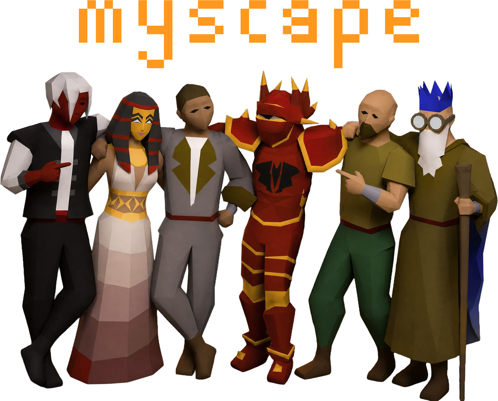

<p align="center">
  
</p>

---

<p align="center"><a href="https://myscape.io">myscape.io</a> is your new favorite OSRS companion site.</p>

<p align="center">myscape is a free, open-source project that was created by an Old School RuneScape player who wanted more functionality than other plugins and websites offered. Comprised of a suite of apps to help you plan, track, and share your OSRS experience, myscape aims to be an integral part of how you play the game.</p>

## Apps

- [Character Overview](https://myscape.io/c/mv7pu): An optionally shareable profile that shows your character's collection log data, skill levels, quest completions, achievement diary tiers, and combat task tiers.
- [Loot Tracker](https://myscape.io/s/njnku7mnas): An enhanced, feature-rich improvement on loot tracking allowing for historical data, drill-downs, and searching.
- [Purchase Goals](https://myscape.io/s/k3efa9ewsu): A sandboxed inventory and gear setup tracker, syncing your current bank's content against your desired purchases, with live Grand Exchange pricing.
- [Storages Viewer](https://myscape.io/s/3fzrz7q5z2): A fully searchable, sortable, and filterable conglomeration of every one of your items, from every storage, across the game.
- [Mindmaps](https://myscape.io/s/5dc8c49ncb): A feature-rich app that allows you to organize your goals and progress, complete with auto-detecting completion functionality.
- [Goal Tracking](https://myscape.io/s/nysq229vq7): A personalized and customizable board for you to fill with your various goals for your character, complete with auto-detecting and updating progress bars.

The links for each app above are examples of optionally shareable, public snapshots that you can create, share, and delete at any time. Many of these public snapshots can be imported into others' myscape apps as well.

## Getting started

1. Create an account and verify your email.
2. Install **myscape** from the RuneLite Plugin Hub.
3. Click "Generate code" on the site and paste it into the plugin's sidebar panel.

## Development

Requires Python 3.12 and PostgreSQL.

```bash
pip install -r requirements.txt
cp .env.example .env   # set DATABASE_URL and SESSION_SECRET_KEY
uvicorn app.main:app --reload
```

The schema is migrated automatically on startup. To change it, edit `app/models.py`, run `alembic revision --autogenerate -m "..."`, review the migration, and commit it with the change. Without `RESEND_API_KEY`, emails are logged to the console instead of sent.

### Configuration

| Variable | Default | Description |
| --- | --- | --- |
| `DATABASE_URL` | required | Postgres connection string. |
| `SESSION_SECRET_KEY` | required | Signs session cookies. |
| `SIGNUPS_ENABLED` | `false` | `true` opens sign-ups; otherwise `/signup` shows "coming soon". |
| `SESSION_COOKIE_HTTPS_ONLY` | `true` | Set `false` only for local `http://` testing. |
| `ICON_CACHE_DIR` | next to `app/icon_cache.py` | Icon cache location (a persistent disk in production). |
| `RESEND_API_KEY` | unset | Enables sending email. |
| `EMAIL_FROM_ADDRESS` | `myscape <noreply@myscape.io>` | Sender address. |

## Deployment

Deployed on Render via `render.yaml` (web service, Postgres, persistent disk). Create it with **New +** → **Blueprint**, then set `RESEND_API_KEY`. Runs as a single instance.

## Links

[Discord](https://discord.gg/myscape) · [Plugin](https://github.com/Mootrius/myscape-plugin)

myscape is a fan project, not affiliated with or endorsed by Jagex. Old School RuneScape is a trademark of Jagex Ltd.
