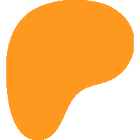

  

---

<a href="https://myscape.io">myscape.io</a> is your new favorite OSRS companion site.

myscape is a free, open-source project that was created by an Old School RuneScape player who wanted more functionality than other plugins and websites offered. Comprised of a suite of apps to help you plan, track, and share your OSRS experience, myscape aims to be an integral part of how you play the game.

## Apps

- [Character Overview](https://myscape.io/c/mv7pu): An optionally shareable profile that shows your character's collection log data, skill levels, quest completions, achievement diary tiers, and combat task tiers.
- [Loot Tracker](https://myscape.io/s/njnku7mnas): An enhanced, feature-rich improvement on loot tracking allowing for historical data, drill-downs, and searching.
- [Purchase Goals](https://myscape.io/s/k3efa9ewsu): A sandboxed inventory and gear setup tracker, syncing your current bank's content against your desired purchases, with live Grand Exchange pricing.
- [Storages Viewer](https://myscape.io/s/3fzrz7q5z2): A fully searchable, sortable, and filterable conglomeration of every one of your items, from every storage, across the game.
- [Mindmaps](https://myscape.io/s/5dc8c49ncb): A feature-rich app that allows you to organize your goals and progress, complete with auto-detecting completion functionality.
- [Goal Tracking](https://myscape.io/s/nysq229vq7): A personalized and customizable board for you to fill with your various goals for your character, complete with auto-detecting and updating progress bars.

## Social

myscape also has a (completely optional) social component. In the section above, the links that each of the app names redirect to are examples of shareable snapshots of each app's content. You can create, share, and delete these snapshots easily on the site.

You can also add people to your myscape friends list, allowing you to view each other's Character Overview pages even when they're set to private.

## Privacy

myscape collects only one piece of personal data that you enter upon account creation, which is your email. As your password is not visible to nor retrievable by us, your email is saved in the case that you ever need to reset your password.

Your OSRS character's data — clogs, skills, diaries, storage contents, etc. — are private by default. They only become public should you explicitly change your Character Overview to public and share your link, or generate shareable links for your other myscape apps and share them. Even then, you can still reset your Character Overview to private or reset the public link, and delete any/all shared links you may have made to the other apps.

The only cookie we keep is to keep you logged in to the site, so that you don't have to log in every time you close your browser or tab. We don't have ads and never will, so we don't collect anything from you for ad personalization or anything in that realm.

## Support

myscape is completely free and always will be. If you would like to support the project financially, you can find the Patreon page [here](https://patreon.com/myscape).

---

  &nbsp;&nbsp;
  &nbsp;&nbsp;
  &nbsp;&nbsp;
  

